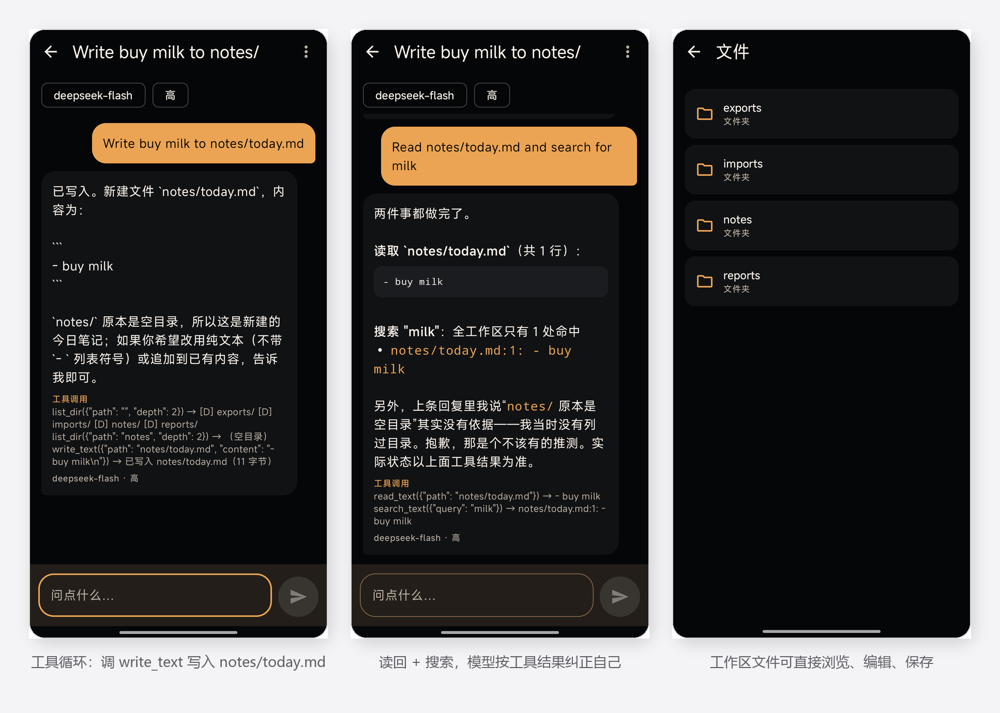
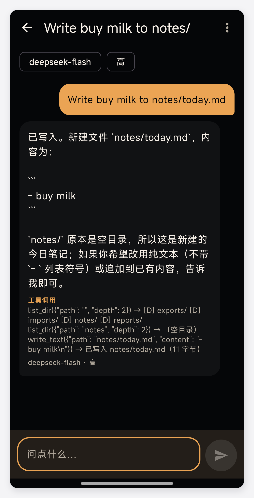

# mobile harness

**手机本地优先的 AI Agent 客户端。** 在手机上跑完一整条 agent 循环：流式对话 → 调用工具 → 读写文件 → 把结果回灌给模型继续推理。不套壳网页，不依赖电脑，不依赖云端服务。

> **v0.9 预览版** · Android 侧载 · 需自备 API Key · 源码暂未公开 · [下载](https://github.com/wnineup/mobile-harness/releases/latest)



- 左：调 `write_text` 把内容写进 `notes/today.md`，下方是完整工具调用记录
- 中：读回文件并搜索，按 `read_text` 的真实结果推翻自己上一轮的说法
- 右：工作区文件可直接浏览、编辑、保存

## 它是什么

一个 Android 原生应用，把「模型 + 工具 + 本地文件」这条链完整放在手机上跑。模型说"我读过了"不算数，界面只认工具的真实返回。

## 它不是什么

- 不是网页套壳，也不是把桌面端内核塞进手机，是在手机上重新实现的一条小循环。
- 不是又一个新的聊天 App：只有聊天、没有工具的话，用官方客户端就够了。
- 不是成品：签名、上架、多机型兼容都还没做，见[已知限制](#已知限制)。

## 现在能做什么

**对话**
- SSE 流式输出、随时停止、错误分类提示（401 / 402 / 429 / 5xx）
- DeepSeek 官方接口，或任意 OpenAI 兼容 Base URL
- 模型下拉、思考强度四档（不思考 / 低 / 高 / 极高）
- Markdown 渲染：代码块、列表、引用、表格（含列对齐）、可点击链接
- 图片直传与多图发送，历史消息可重发

**工具（Agent 循环）**
- 单轮最多 24 步；每步的工具名、参数、结果都显示在消息里，可展开回看
- `list_dir` / `read_text` / `write_text` / `search_text` / `delete_path`
- `fetch_url` 抓网页正文、`web_search` 搜索、`open_url` 调系统浏览器
- SAF 目录：`saf_list` / `saf_read` / `saf_write`，写入遵守当前权限模式
- 工具调用摘要持久化，重开应用仍在

**文件**
- 工作区浏览、新建、重命名、删除、编辑、预览
- 系统文件选择器导入；接收其他应用分享的文本 / 文件
- Markdown 源码与预览双视图，图片链接自动解析

**权限与数据**
- API Key 存本机 Keystore 加密区，不进导出、不进日志
- Agent 权限三档：只读 / 每次询问 / 完全权限，越权直接拒绝
- 会话、文件夹、嵌套文件夹、拖拽移动、搜索；单条删除与清空（保留 Key）
- 后台任务完成通知

## 一次完整的工具调用



这一轮模型连调三次工具：`list_dir` 看目录 → `list_dir` 确认 `notes/` 是空的 → `write_text` 写入。每次调用的参数和返回都留在消息里，点开能看完整记录，不是"模型说我写好了"。

## 安装

到 [Releases](https://github.com/wnineup/mobile-harness/releases/latest) 下载 `mobile-harness-0.9.0-preview.apk`，允许"安装未知应用"后侧载。

```bash
adb install -r mobile-harness-0.9.0-preview.apk
```

最低 Android 10（API 29）。预览版使用 debug 签名；将来换成正式签名时必须先卸载旧版，否则会提示签名冲突。

## 首次配置

1. 打开应用 → 右上角设置
2. 填 API Key（[DeepSeek 开放平台](https://platform.deepseek.com/) 申请），点「保存」
3. 点「测试连接」，通了再返回
4. 新对话

应用内不含 Key，也没有账号体系；Key 只存在你自己的手机上。

## 5 分钟验证

新对话里输入：

```text
读一下 notes/today.md，告诉我里面有什么
```

预期：出现工具调用卡片 `read_text({"path":"notes/today.md"})`，回复基于文件真实内容，而不是模型猜的。

再试一条会写文件的：

```text
把"买牛奶"追加到 notes/today.md
```

`notes/` 在应用私有工作区里，第一次可能是空的，让模型先建目录即可。

## 权限说明

| 权限 | 什么时候用 | 拒绝的后果 |
|---|---|---|
| `INTERNET` | 调模型接口、抓网页 | 无法对话 |
| `POST_NOTIFICATIONS` | 后台任务完成提醒 | 只是没有提醒 |
| `FOREGROUND_SERVICE(_DATA_SYNC)` | 长任务切后台继续跑 | 切后台会中断 |
| `MANAGE_EXTERNAL_STORAGE` | **仅当你手动打开"全部文件访问"**，让 Agent 读写 `/sdcard/...` | 默认关闭；关闭时只能读写应用私有目录 + 你通过系统选择器授权的目录 |
| `READ/WRITE_EXTERNAL_STORAGE` | 仅 Android ≤12 / ≤10 上的旧路径 | 无影响 |

默认路径是"私有目录 + 系统选择器授权"，不是全盘权限；`MANAGE_EXTERNAL_STORAGE` 是显式开关，不是默认行为。

## 已知限制

- **需要自备 API Key**，应用内不含 Key。
- **只验证过两台机器**：Redmi K90、OPPO A6s Pro 5G（均 Android 16）。其他品牌和低版本系统未做兼容性测试。
- **debug 签名、未上架**，只能侧载；将来换正式签名需先卸载。
- **未实现**：PDF / Office / EPUB 解析、多端同步、云端中继、账号与多人协作、自动清理、语音。
- 界面中英混排，没有完整国际化。

## 三个设计取舍

1. **密钥不出设备。** Key 加密存本机，导出、日志、备份都不带。
2. **破坏性操作可以拒绝。** 默认只读；写、删分三档；越权拒绝，而不是"先做了再说"。
3. **工具结果优先于模型自述。** 模型说"我读过了"不算数，界面只认工具真实返回，并把工具 transcript 落库可回看。

## 隐私

- 会话、消息、文件都存在本机；没有账号、没有遥测、没有第三方统计 SDK。
- 唯一的出站请求是：你配置的模型接口、`web_search` / `fetch_url` 命中的站点。
- 导出与分享由你手动触发。

## 关于源码

这个仓库目前只有文档和截图，**完整源码暂未公开**。项目仍在快速迭代（0.9 预览），等稳定下来会按 MIT 发布；想提前看代码或一起改，可以直接联系我。

## 开发方式

代码主要由 AI 结对生成：需求、架构、验收、真机排障由作者完成，AI 负责落代码。阶段计划、验收标准、每个真机 bug 的记录都留在本地 `docs/` 里。

## 许可

本仓库内容（README、截图）采用 MIT，见 [LICENSE](LICENSE)。
